# 👋 Yuu-2k

> FiveM Developer — Lua

---

## ⚡ Focus

- FiveM Development
- Lua
- Clean & Optimized Resources
- UI & Gameplay Systems

```lua
local developer = {
    name = "Yuu-2k",
    platform = "FiveM",
    language = "Lua",
    philosophy = "Simple. Clean. Efficient."
}
```

<!-- ghstats:start -->
<div align="center">
    <picture>
      <source media="(prefers-color-scheme: dark)" srcset="ghstats/stats-dark.svg">
      <source media="(prefers-color-scheme: light)" srcset="ghstats/stats-light.svg">
      
    </picture>
</div>
<!-- ghstats:end -->
